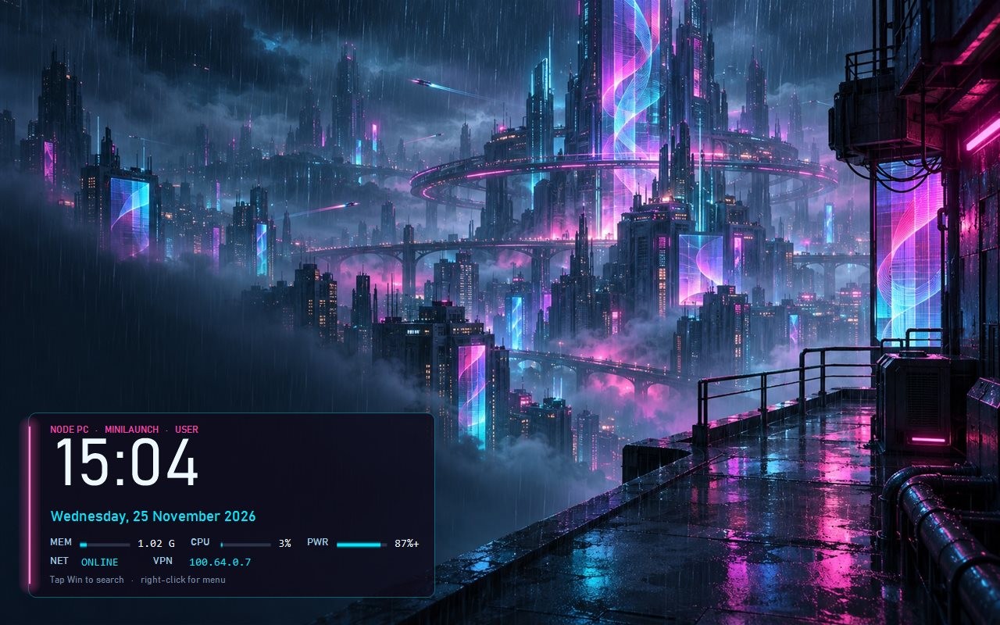
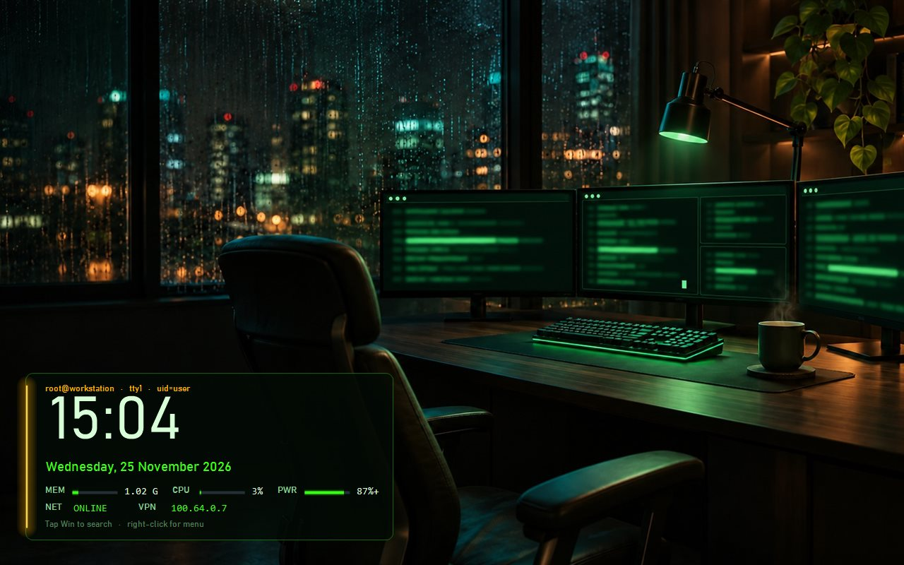
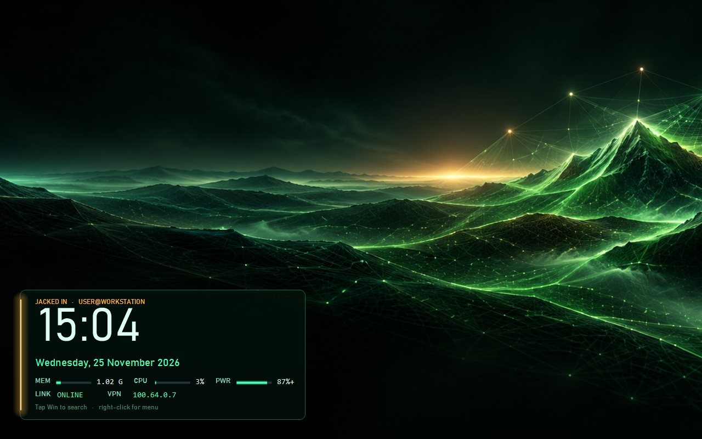
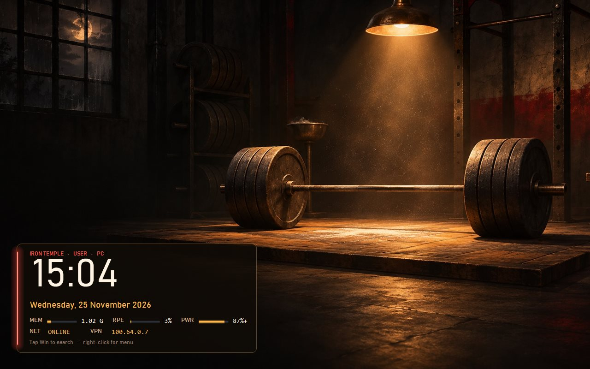
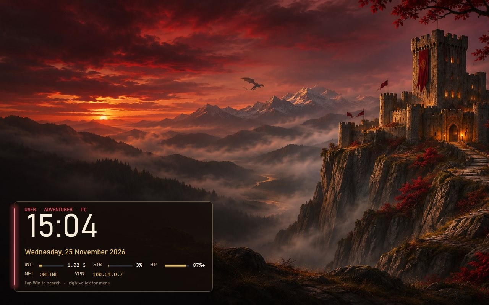
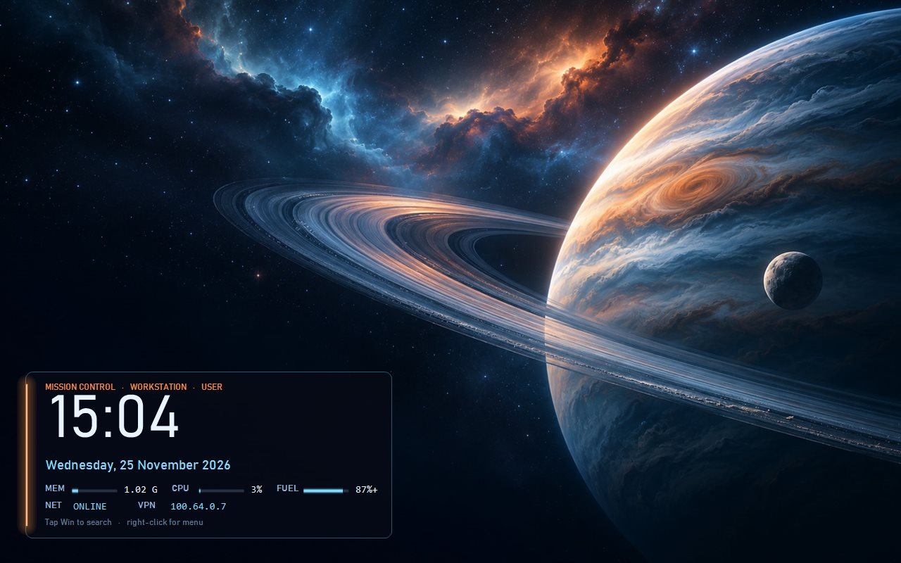
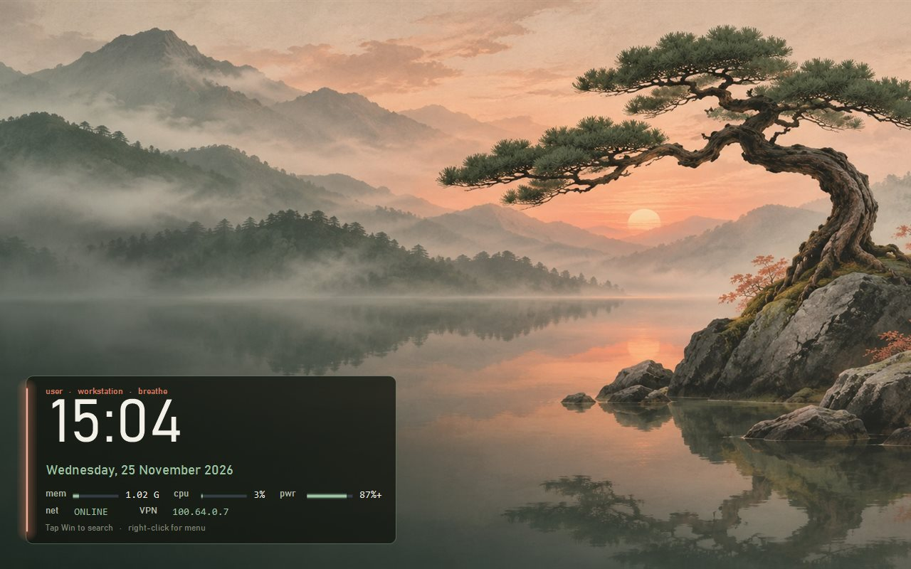
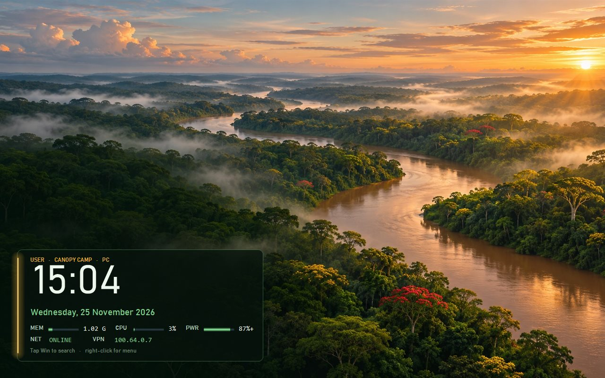
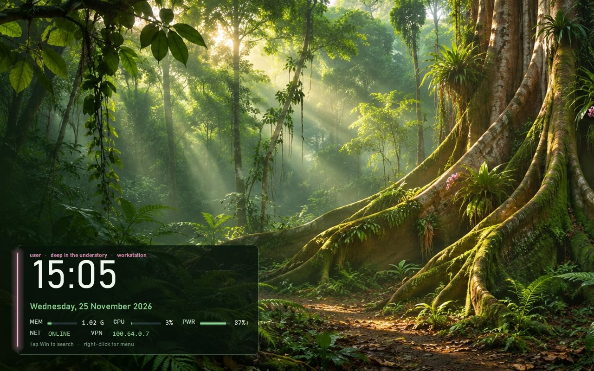

# postmodern-windows

Windows 10, stripped to the studs and given a Linux-style desktop.

Explorer is gone. In its place is **minilaunch**, a small (~85 KB) shell that draws the desktop and gives you
a dmenu-style launcher, a dock for minimized windows and trackpad swipes between windows. Underneath, over 100
background services, the telemetry and the bundled apps are switched off. On the 2012 MacBook Pro it was
built on, the whole system idled at about **1.3 GB of RAM and 3% CPU**; turning Defender back on adds roughly
300 MB.



> **Status: pre-release.** This repo currently holds minilaunch, its themes and the helper scripts. The
> installer that applies the full setup (debloat, shell, terminal, lock screen) is being written; see
> [docs/INVENTORY.md](docs/INVENTORY.md) for exactly what it will change.

## What you get

- **Launcher**: tap the Windows key and type. Fuzzy search over Start-menu apps and system tools
  ("wifi", "reboot", "files"); most-used apps rise to the top. `>command` runs PowerShell, paths and
  URLs open directly, Ctrl+Shift+Enter runs as administrator.
- **Desktop**: wallpaper with a live clock and RAM, CPU, battery and network readout. Right-click for a
  power menu; double-click for the launcher.
- **Dock**: minimized windows collect on the right edge; it tucks away when a window covers it.
- **Swipes**: three fingers left or right walks through open windows (needs a precision touchpad).
- **Themes**: nine of them, each with its own wallpaper, lock screen, accent colours, HUD text and
  Windows Terminal colour scheme. Tap Win, type `theme`.

## Themes

| | | |
|---|---|---|
|  **Cyberpunk** (default) |  **Hacker** |  **Cyberspace** |
|  **Weightlifting** |  **Dungeons & Dice** |  **Deep Space** |
|  **Zen** |  **Rainforest** |  **Jungle** |

A theme is a folder in `minilaunch/themes/` with `wallpaper.jpg`, `lock.jpg` and a `theme.ini`; add your own
the same way.

## What you give up

This is a deliberate trade. Without Explorer:

- The **Settings app, Microsoft Store apps and the Windows Security app** don't open (they need Explorer's
  shell). Classic tools all work, and the launcher lists them: Control Panel, Network Connections, Sound,
  Power Options, Device Manager, a Wi-Fi picker and so on.
- There's no taskbar, system tray or notification centre.
- The desktop covers the primary monitor only.

Switching back is one script and a sign-out: `scripts\shell-explorer.cmd`.

## Security stance

- **Microsoft Defender stays on**: real-time protection, cloud protection and Tamper Protection. The
  installer tunes its scans to stay quiet; it never disables it.
- **Windows Update is switched off by default**. Windows 10 22H2 is out of support for most users anyway;
  `-KeepUpdates` leaves it alone (for example on machines with extended security updates).
- **CPU vulnerability mitigations are left on.** Turning them off is a separate opt-in.

## Build

Requires Windows 10 (22H2, x64). No SDK needed: minilaunch compiles with the C# compiler built into the
.NET Framework.

```powershell
.\build.ps1
.\build\minilaunch\minilaunch.exe --desktop          # try it without replacing Explorer
.\build\minilaunch\minilaunch.exe --render shot.png  # render the desktop to an image
```

Make it your shell (per user, no admin): `scripts\shell-minimal.cmd`, then sign out.

## Known limitations

- Tested on one machine so far (2012 MacBook Pro, Windows 10 Pro 22H2). Windows 11 is untested.
- The Wi-Fi picker parses `netsh` output and only works on English-language Windows.

## Credits

- Theme art generated with OpenAI's image model via Codex CLI; see `minilaunch/themes/CREDITS.txt`.
- On MacBooks, trackpad gestures use [imbushuo/mac-precision-touchpad](https://github.com/imbushuo/mac-precision-touchpad).
- Terminal: [Windows Terminal](https://github.com/microsoft/terminal) (portable). Font: [Iosevka](https://github.com/be5invis/Iosevka).

## License

MIT. See [LICENSE](LICENSE).
